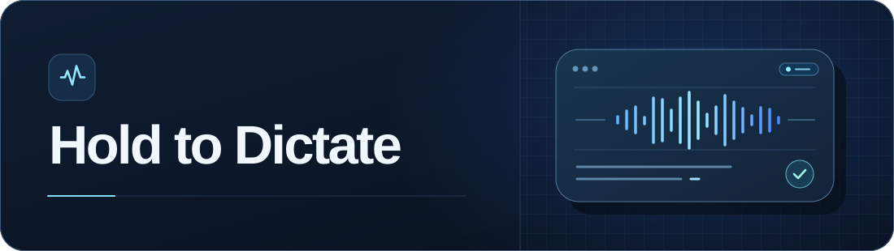
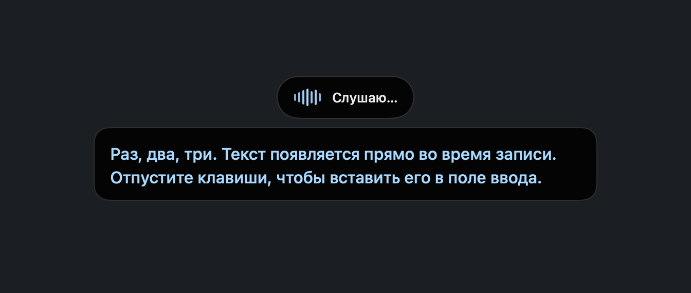

<div align="center">
  <h1></h1>
  <p><strong>Зажмите клавиши. Скажите. Отпустите, чтобы вставить.</strong></p>
  <p>Голосовой ввод прямо в программе, в которой вы уже работаете.</p>
  <p>
    <a href="https://github.com/slpkbt/hold-to-dictate/actions/workflows/macos.yml"></a>
    <a href="https://github.com/slpkbt/hold-to-dictate/actions/workflows/windows.yml"></a>
    <a href="LICENSE"></a>
  </p>
  <p>
    <a href="#быстрый-старт"><strong>Быстрый старт</strong></a>
    &nbsp;·&nbsp;
    <a href="#распознавание"><strong>Распознавание</strong></a>
    &nbsp;·&nbsp;
    <a href="#настройки"><strong>Настройки</strong></a>
    &nbsp;·&nbsp;
    <a href="README.md"><strong>English</strong></a>
  </p>
</div>

---

## Как это работает

| 1. Зажмите | 2. Говорите | 3. Отпустите |
| :--- | :--- | :--- |
| Удерживайте настроенное сочетание. | Оверлей показывает громкость и промежуточный текст, когда он доступен. | Готовый текст копируется, а при включённой автовставке попадает в исходное поле, если фокус не сменился. |

<p align="center">
  
  <br /><sub>Оверлей на macOS. Баннер сверху иллюстративный.</sub>
</p>

**Приложение не отправляет текст за вас** и не нажимает Enter. Записи и история расшифровок не пишутся на диск. Готовый текст остаётся в системном буфере обмена.

## Быстрый старт

| Платформа | Сочетание по умолчанию | Как начать |
| :--- | :--- | :--- |
| **macOS 13+** · Apple Silicon / Intel | <kbd>⌘</kbd> <kbd>⇧</kbd> <kbd>K</kbd> | [Скачать для Mac](https://github.com/slpkbt/hold-to-dictate/releases) или [собрать](#macos) |
| **Windows 11** / [поддерживаемые Windows 10](https://learn.microsoft.com/en-us/dotnet/core/install/windows#supported-versions) · x64 | <kbd>Ctrl</kbd> <kbd>Shift</kbd> <kbd>K</kbd> | [Собрать и настроить для Windows](#windows) |

### macOS

1. Скачайте ZIP в разделе [Releases](https://github.com/slpkbt/hold-to-dictate/releases), распакуйте и переместите **Hold to Dictate.app** в **Программы**. Архив подписан локальной подписью и не нотариализован Apple. Если предпочитаете собрать самостоятельно, нужны Xcode Command Line Tools.
2. Запустите приложение и нажмите значок волны в строке меню. В **Разрешения macOS** выдайте доступ к микрофону и включите **Универсальный доступ**, чтобы работала автовставка. Без универсального доступа текст всё равно копируется.
3. Зажмите <kbd>⌘</kbd> <kbd>⇧</kbd> <kbd>K</kbd>, чтобы попробовать. Если нужно запускать программу при входе в систему, включите **Запускать при входе** в том же меню.

<details>
<summary><strong>Собрать, запустить или открыть превью на Mac</strong></summary>

```bash
./scripts/build.sh
./scripts/run.sh
./scripts/run.sh --preview
```

Превью показывает пример текста и не требует доступа к микрофону или сети.

</details>

### Windows

1. Для локальной сборки установите [.NET 10 SDK](https://dotnet.microsoft.com/download/dotnet/10.0), клонируйте репозиторий и выполните в PowerShell:

   ```powershell
   .\scripts\build-windows.ps1 -Check
   ```

   Самодостаточный ZIP для x64 и SHA-256 появятся в `dist\windows\`. Распакуйте весь архив в постоянную папку. Отдельно устанавливать .NET для запуска из ZIP не нужно; архивная сборка не подписана. Windows-сборки публикуются как артефакты [Windows Actions](https://github.com/slpkbt/hold-to-dictate/actions/workflows/windows.yml), не в ZIP для macOS.
2. Запустите **HoldToDictate.exe**. Найдите **Hold to Dictate** в области уведомлений (в том числе среди скрытых значков) и откройте **Settings…**. Зажмите <kbd>Ctrl</kbd> <kbd>Shift</kbd> <kbd>K</kbd>, говорите и отпустите букву или любой модификатор для завершения. <kbd>Esc</kbd> отменяет запись. По умолчанию Windows только копирует текст. Для вставки нажмите <kbd>Ctrl</kbd> <kbd>V</kbd> или включите её автоматически в настройках.
3. При необходимости [разрешите классическим приложениям доступ к микрофону](https://support.microsoft.com/ru-ru/windows/privacy/turn-on-app-permissions-for-your-microphone-in-windows). Для локального режима выберите установленный речевой движок в настройках. **Язык интерфейса Windows сам по себе не гарантирует наличие локального распознавания.**

**Preview overlay** в трее показывает оверлей без микрофона. Если сочетание занято, поменяйте его в настройках. Если окно администратора не принимает автовставку, вставьте вручную, не повышая права Hold to Dictate.

## Распознавание

| Платформа | Режим | Куда идёт аудио |
| :--- | :--- | :--- |
| macOS | **Codex** (по умолчанию) | PCM-аудио отправляется в ChatGPT во время удержания клавиш. Оверлей показывает сегменты по мере их получения. |
| macOS | **На устройстве** | Apple Speech обрабатывает звук на Mac. Для выбранного языка нужна локальная модель. |
| Windows | **На устройстве** (по умолчанию) | Системное распознавание Windows обрабатывает звук локально, если установлен модуль для нужного языка. |
| Windows | **Codex** (включается вручную) | Поток аудио идёт в ChatGPT через существующий файловый вход Codex. |

<details>
<summary><strong>Как работает вход Codex</strong></summary>

Программа использует существующий вход в Codex через ChatGPT: читает сессию из `$CODEX_HOME/auth.json` или из `~/.codex/auth.json` на Mac / `%USERPROFILE%\.codex\auth.json` на Windows, если переменная не задана. Подключается непосредственно к ChatGPT по приватному протоколу диктовки, обнаруженному в Desktop 26.1111.21308. Это не публичный API: доступ зависит от аккаунта и может поменяться. Данные входа не печатаются и не сохраняются отдельно. Входом и обновлением сессии управляет Codex. Если сессия истекла, откройте Codex и войдите снова. Сессии, хранящиеся в Keychain, не поддерживаются.

</details>

## Настройки

### macOS

Значок волны → **Открыть настройки**. Сохраните JSON и выберите **Применить настройки**. В файле достаточно оставить только те параметры, которые нужно изменить. См. [настройки по умолчанию](Resources/settings.json).

| Параметр | Что меняет |
| :--- | :--- |
| `shortcut` | Например, `cmd+shift+k` или `ctrl+opt+space`. Модификаторы: `cmd`, `shift`, `opt`, `ctrl`. Клавиши: A–Z, 0–9, Space, F1–F12 по физической раскладке. |
| `engine` | `codex` или `onDevice`. |
| `language` | Локаль для распознавания на устройстве. В режиме Codex язык определяет сервер. |
| `pasteAutomatically` | Автовставка в исходное поле, если это безопасно. Текст попадёт в буфер при любом значении. |
| `playSound`, `startSound` | Звук начала записи: включение, название системного звука или абсолютный путь к файлу. |
| `appearance.textColor` | Цвет текста и волны в формате `#RRGGBB`. |
| `appearance.backgroundOpacity` | Непрозрачность подложки: 0.42–1. |
| `appearance.width`, `appearance.textSize` | Ширина блока текста в пунктах и размер текста от 12 до 24 пунктов. |
| `appearance.maxLines` | До 14 видимых строк. Для длинной записи отображаются последние строки. |
| `appearance.verticalOffset`, `appearance.horizontalOffset` | Смещение от центра экрана в пунктах. |
| `appearance.reduceMotion` | Отключение анимации. Оверлей также учитывает системную настройку **Уменьшение движения**. |

### Windows

Правый клик по значку в трее → **Settings…**. Настройки сохраняются в `%LOCALAPPDATA%\HoldToDictate\settings.json` отдельно от Mac.

| Поле | Что меняет |
| :--- | :--- |
| **Global shortcut** | По умолчанию `Ctrl+Shift+K`; поддерживаются Ctrl, Alt, Shift, Win и A–Z, 0–9, Space, F1–F11. Зарезервированные и занятые сочетания не применяются. |
| **Recognition engine**, **Windows Speech language** | На устройстве по умолчанию. Если язык не выбран, берётся язык интерфейса Windows или первый доступный движок. Codex включается вручную. |
| **Paste into the original field when safe** | По умолчанию выкл. Автовставка требует совпадения исходного окна и поля ввода; иначе остаётся только копирование. |
| **Overlay accent**, **Overlay width** | Цвет в HEX и ширина в логических пикселях. |
| **Play a sound**, **Launch at sign-in** | По умолчанию оба выключены. Автозапуск привязан к текущему пути приложения. |

Одна запись на Windows ограничена 60 секундами.

## Разработка

На macOS команда `./scripts/check.sh` запускает локальные проверки, а `./scripts/release.sh` кладёт универсальный ZIP и SHA-256 в `dist/`. Версия берётся из `Resources/Info.plist`. GitHub Actions проверяет архив и публикует GitHub Release при пуше тега `v<версия>`. См. [устройство порта и список проверок Windows](docs/windows-port.md).

Предложения и баги можно оставить в [GitHub Issues](https://github.com/slpkbt/hold-to-dictate/issues). Укажите версию ОС, режим распознавания и этап, на котором возникла проблема: запись, распознавание или вставка. Не прикладывайте данные входа; аудио и расшифровки добавляйте только если готовы сделать их публичными.

## Лицензия

[MIT](LICENSE)
