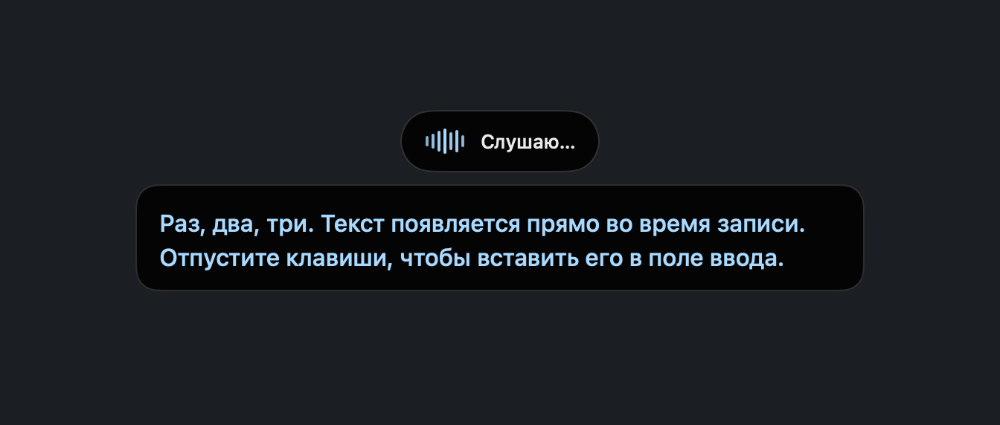

# Hold to Dictate

**Зажмите ⌘⇧K, говорите, отпустите.** Пока сочетание удерживается, плавающий оверлей показывает громкость и промежуточный текст. Отпустите клавиши, чтобы скопировать расшифровку и вставить её в активное поле.

macOS 13+ · Apple Silicon и Intel · Swift, AppKit, SwiftUI · без сторонних библиотек

## Установка

Скачайте **Hold to Dictate** в разделе **Releases**, распакуйте ZIP и переместите приложение в **Программы**. Бинарник подписан локальной подписью и распространяется без нотариализации Apple. Альтернатива скачиванию бинарника — локальная сборка с помощью Xcode Command Line Tools.

Откройте приложение. В строке меню появится значок волны. Пункт **Разрешения macOS** запрашивает доступ к микрофону и открывает **Универсальный доступ** для автовставки. Без второго разрешения программа всё равно копирует текст. Если нужен запуск при каждом входе, включите **Запускать при входе** в том же меню.

### Сборка и запуск из исходников

    ./scripts/build.sh
    ./scripts/run.sh
    ./scripts/run.sh --preview

Превью показывает оверлей на готовом тексте и работает без микрофона, сети и разрешений.

## Распознавание

| Режим | Как работает |
| --- | --- |
| **Codex** (по умолчанию) | Отправляет PCM-аудио во время удержания хоткея и показывает сегменты, когда их возвращает поток диктовки Codex. Использует существующий вход Codex через ChatGPT с файловым хранилищем. Подключение зависит от доступности потока для аккаунта и от версии протокола. |
| **На устройстве** | Использует системное распознавание Apple Speech. Аудио остаётся на Mac. Для выбранного языка должна быть доступна локальная модель. |

Codex-режим читает текущую сессию из `$CODEX_HOME/auth.json` или `~/.codex/auth.json`, если переменная не задана. Он использует официальный домен ChatGPT и приватный протокол диктовки, обнаруженный в версии Desktop 26.1111.21308. Приложение не печатает данные входа и не сохраняет их отдельно. Входом и обновлением сессии управляет сам Codex. При истечении сессии откройте Codex и проверьте, что вы всё ещё вошли через ChatGPT. Учётные данные из Keychain в этой версии не поддерживаются.

Микрофон открывается при удержании хоткея. Записи и история текста на диск не пишутся. По отпусканию итог остаётся в системном буфере. При смене приложения или распознанного поля фокуса автовставка пропускается. Приложение никогда не нажимает Enter.

## Настройки

Значок волны → **Открыть настройки**. Сохраните JSON и выберите **Применить настройки**. Можно оставить в файле только переопределения. Значения по умолчанию — в [Resources/settings.json](Resources/settings.json).

| Параметр | Значение |
| --- | --- |
| `shortcut` | Например, `cmd+shift+k` или `ctrl+opt+space`. Модификаторы `cmd`, `shift`, `opt`, `ctrl`. Клавиши A–Z, 0–9, Space, F1–F12 по физической раскладке. |
| `engine` | `codex` или `onDevice`. |
| `language` | Локаль для `onDevice`. В режиме Codex язык определяет сервер. |
| `pasteAutomatically` | Автовставка в исходное поле. Буфер заполняется при любом значении. |
| `playSound` | Включает сигнал начала записи. |
| `startSound` | Название системного звука или абсолютный путь к аудиофайлу. |
| `appearance.textColor` | Цвет текста и волны, формат `#RRGGBB`. |
| `appearance.backgroundOpacity` | Непрозрачность подложки от 0.42 до 1. |
| `appearance.width` | Ширина блока текста в пунктах. |
| `appearance.textSize` | Размер текста от 12 до 24 пунктов. |
| `appearance.maxLines` | До 14 видимых строк. Для длинной записи отображаются последние строки. |
| `appearance.verticalOffset` | Смещение оверлея по вертикали относительно середины экрана в пунктах. |
| `appearance.horizontalOffset` | Смещение по горизонтали. |
| `appearance.reduceMotion` | Отключает анимацию оверлея. |

Оверлей учитывает системную настройку **Уменьшение движения**. Если хоткей занят другой программой, выберите другое сочетание.

## Релиз

    ./scripts/release.sh

Локальные проверки запускаются командой `./scripts/check.sh`.

Скрипт кладёт универсальный ZIP и SHA-256 в `dist/`. Версия берётся из `Resources/Info.plist`. GitHub Actions собирает архив на macOS, проверяет контрольную сумму и публикует GitHub Release при пуше тега `v<версия>`.

## Лицензия

[MIT](LICENSE).
